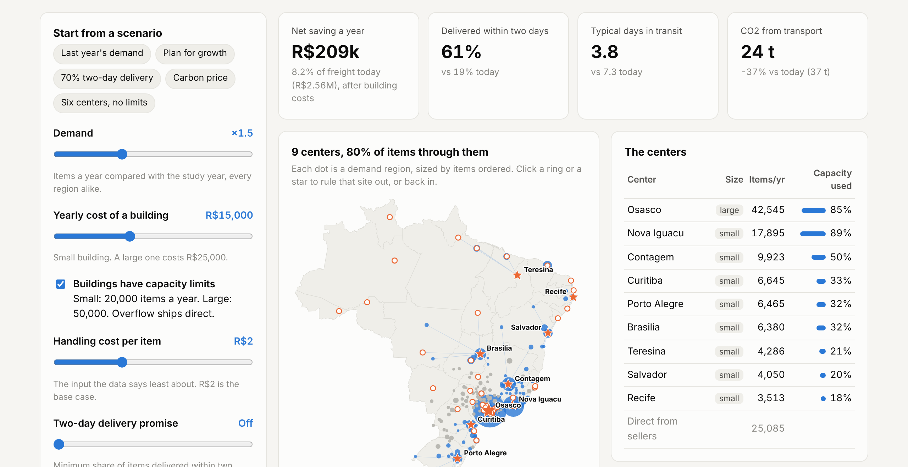
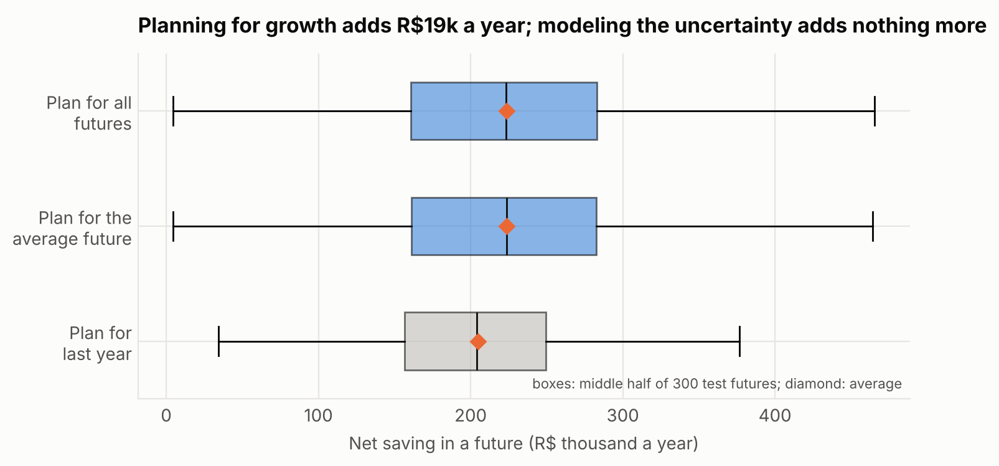
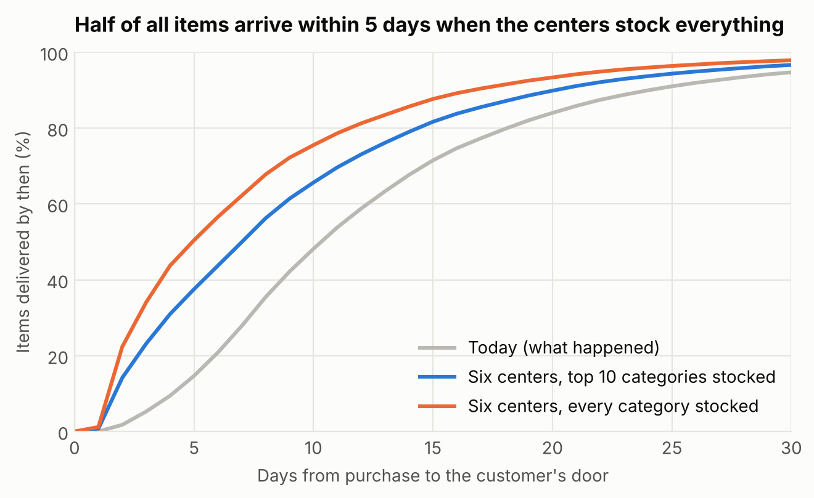

# Supply Chain Network Optimizer

**Where should an online marketplace build its warehouses, how big, and what happens when demand grows, trucks run late and Black Friday hits?**

This project answers that for Olist, a Brazilian e-commerce marketplace, using 84,523 real shipments. It goes from SQL analysis to a freight cost model, facility location optimization, an inventory policy, a two-stage stochastic program, a discrete-event simulation and a cost-versus-carbon analysis. It ends in a decision tool that solves the optimization live in the browser.

**[Open the live Network Design Studio](https://varunnadgir.github.io/supply-chain-optimizer/)** · **[Read the two-page memo](https://varunnadgir.github.io/supply-chain-optimizer/memo.html)**

[](https://varunnadgir.github.io/supply-chain-optimizer/)

**Tools:** Python (pandas, NumPy, SciPy, PuLP, HiGHS, SimPy, matplotlib, pytest), SQL (SQLite), Jupyter, JavaScript and WebAssembly.

## The result in one paragraph

Today every Olist order ships as a single parcel straight from the seller. 72% of items ship out of São Paulo state, but only 43% are delivered there, so most parcels travel far. Planning for the growth the business is likely to see, the model recommends **nine or ten regional fulfillment centers, with one large building in the São Paulo metro area**. That network saves about **R\$220,000 a year after building costs**, triples the share of items delivered within two days (**19% to 61%**) and cuts transport **CO2 by about 37%**. A day-by-day simulation on the real order stream shows customers would get their orders in **9.4 days instead of 12.7**, and it caught a mismatch between the network model and the inventory plan that the yearly numbers hid.

## What the project found

1. **A few regional centers pay off.** With last year's demand, six centers cut freight by 11.8% and typical transit time by 41% (notebook 2). One item in four should keep shipping direct, because a stop at a center costs more than it saves for customers already near their sellers.
2. **Plan for growth, not for last year.** A network designed for last year's demand leaves about R\$19,000 a year (8%) on the table once demand grows, because the São Paulo and Rio de Janeiro buildings end up too small (notebook 5).
3. **The sophisticated model did not beat the simple one, and the reason is understood.** A two-stage stochastic program over 50 possible futures gave the same value as planning for the single average future. Shipping overflow direct makes a wrong guess cheap to fix. Perfect foresight would add only about 3%.
4. **Risk is a choice.** Giving up under 1% of the average saving buys about 7% more saving in the worst 10% of futures (nine centers instead of ten).
5. **Speed is nearly free up to a point.** The cost-optimal network already delivers 61% of items in two days. Promising 70% needs 18 centers and costs about a quarter of the saving.
6. **The simulation found what the averages hid.** The network model assumed every product would be stocked at the centers; the inventory plan stocked the top ten categories. Run together, only 44% of items go through a center instead of 74%, and the freight saving is 7% instead of 11.8%. Stocking every category closes the gap; the extra inventory roughly pays for itself, and half of all orders then arrive within five days (notebook 6).
7. **Cost and carbon point the same way.** The cheapest network also cuts transport CO2 by about a third. A carbon price would need to be about fifty times the EU's before it changed the design (notebook 7).
8. **The core sites are robust.** Salvador, Porto Alegre, the Rio de Janeiro metro and the Belo Horizonte metro are chosen under every cost, growth and resampling test.

## How it is built

Seven notebooks, meant to be read in order. Each one starts with its question and ends with what it found.

| Notebook | Question | Methods |
|---|---|---|
| [1. SQL exploration](notebooks/01_sql_exploration.ipynb) | Where are customers and sellers, and what does distance cost? | SQL: joins across six tables, CTEs, window functions, date arithmetic |
| [2. Network design](notebooks/02_network_design.ipynb) | Where should centers go to minimize freight? | Least-squares freight rate card, p-median MILP with a ship-direct option, brute-force verification, sensitivity analysis |
| [3. Inventory policy](notebooks/03_inventory_policy.ipynb) | How much stock should each center hold? | Exponential smoothing forecasts, order-up-to policy, replay test on unseen weeks, risk pooling |
| [4. Trade-offs and robustness](notebooks/04_tradeoffs_and_robustness.ipynb) | Does the answer survive inventory costs and different data? | Bootstrap resampling, out-of-sample regret, cost versus speed |
| [5. Designing for an uncertain future](notebooks/05_designing_for_an_uncertain_future.ipynb) | Which network should be built once, for years of uncertain growth? | Two-stage stochastic MILP with capacity, fixed costs and building sizes, value of the stochastic solution, value of perfect information, CVaR risk frontier, service-level constraints |
| [6. Simulating the network](notebooks/06_simulating_the_network.ipynb) | Does the plan hold when it runs one order at a time? | Discrete-event simulation in SimPy: real order stream, random transit and lead times, picking capacity, Black Friday |
| [7. Cost versus carbon](notebooks/07_cost_vs_carbon.ipynb) | What does the network do to emissions? | Emission factors per tonne-km, carbon pricing in the objective, factor sensitivity |

The **[Network Design Studio](https://varunnadgir.github.io/supply-chain-optimizer/)** puts the notebook 5 model in the browser. Visitors change demand growth, building costs, capacity limits, handling cost, a two-day delivery promise and a carbon price, or rule sites out on the map, and the HiGHS solver (compiled to WebAssembly) re-solves the mixed-integer program in well under a second for most settings. A [simpler precomputed version](https://varunnadgir.github.io/supply-chain-optimizer/explorer.html) shows the notebook 2 results.





## Key numbers

| | Today | Recommended network |
|---|---|---|
| Freight, study year | R\$1.70 million | 11.8% lower with six centers (notebook 2) |
| Net saving after building costs, demand 1.5x | | about R\$220,000 a year (notebook 5) |
| Items delivered within two days | 19% | 61% |
| Days from purchase to the customer's door (simulated) | 12.7 | 9.4 with the top ten categories stocked, 7.5 with everything stocked |
| Transport CO2 | | about 37% lower |

The R\$ figures describe this dataset, which is a sample of Olist's orders. The percentages are the transferable result.

## Assumptions and limits

Each assumption below is tested in the notebook that uses it.

- **Handling cost at a center is R\$2.00 per item.** The most sensitive input in notebook 2: between R\$1 and R\$3 the freight saving ranges from about 16% to 9%.
- **Building costs and sizes** (notebook 5) are R\$15,000 a year for a small building holding 20,000 items and R\$25,000 for a large one holding 50,000. The number of centers depends on these; the four core sites do not.
- **Future demand** grows by a median of 1.5 times with uneven regional growth, calibrated on the 2017 to 2018 growth in the data. Sellers are assumed to stay where they are.
- **Bulk freight** to a center is priced at the distance rate observed in parcel prices, which likely overstates real truck rates and keeps the savings conservative.
- **Distances are straight-line.** The freight rate card explains 57% of the variation in parcel prices: reasonable for network totals, weak for pricing a single parcel.
- **Inventory** is planned by category with a one-week lead time and a 25% yearly holding rate. The simulation shows the policy depends heavily on the lead time.
- **Emission factors** are 0.25 kg CO2 per tonne-km for parcels and 0.10 for full trucks. The size of the CO2 cut depends on them; the direction holds across the plausible range.

## Run it yourself

Requires Python 3.10 or newer.

```bash
git clone https://github.com/varunnadgir/supply-chain-optimizer.git
cd supply-chain-optimizer
pip install -r requirements.txt
```

Download the data (see [`data/README.md`](data/README.md)), then:

```bash
python src/build_database.py      # builds data/olist.db, about 30 seconds
jupyter notebook                  # open the notebooks in order: 01 to 07
pytest -q                         # 13 automated checks, a few minutes
```

Notebooks 2 and 4 take about three minutes each and notebook 5 about twenty, because they solve optimization models many times. The others run in a minute or two.

To rebuild the data behind the web pages: `python src/build_live_data.py` for the studio and `python src/build_scenarios.py` for the precomputed explorer. Preview them with `python -m http.server` inside `docs/`.

## Repository layout

```
data/           raw CSVs and the SQLite database (not committed), plus data notes
sql/            every SQL query used in the project, by name
src/            database build, network, inventory and stochastic models, simulation, page data builders
notebooks/      the seven notebooks, with outputs
docs/           the Network Design Studio, the precomputed explorer and the memo (GitHub Pages)
tests/          automated checks that the models reproduce the notebooks and behave sensibly
figures/        charts saved by the notebooks
results/        tables saved by the notebooks
```

## Data source

[Brazilian E-Commerce Public Dataset by Olist](https://www.kaggle.com/datasets/olistbr/brazilian-ecommerce), released on Kaggle under CC BY-NC-SA 4.0.
