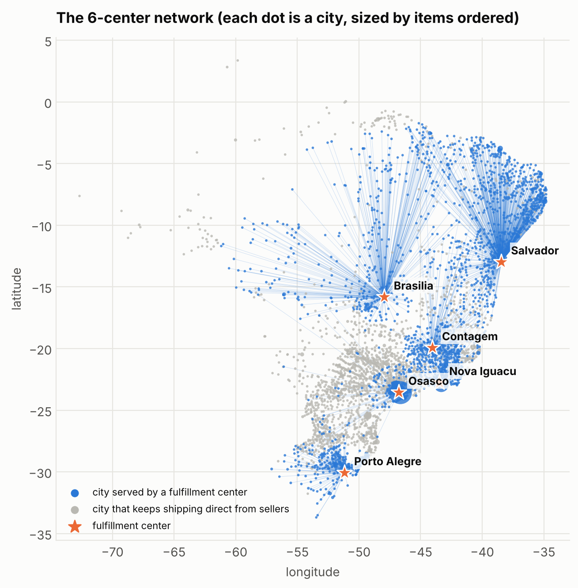
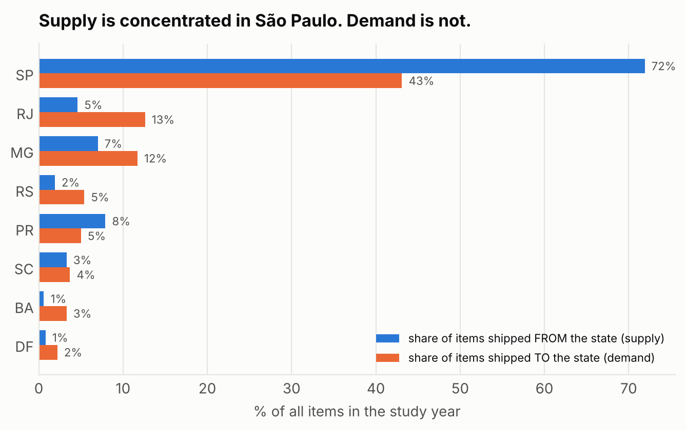
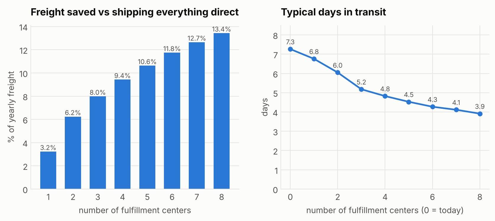
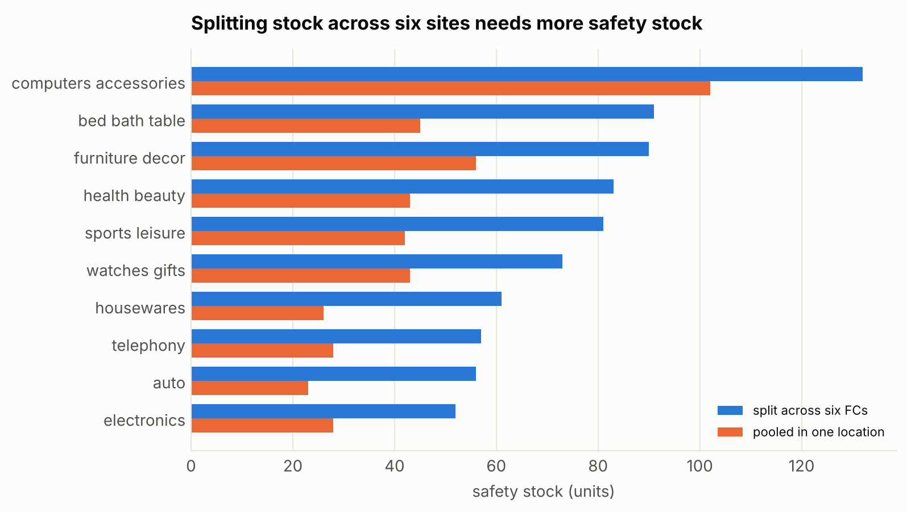

# Supply Chain Network Optimizer

**Where should an online marketplace put its fulfillment centers, and how much stock should each one hold?**

This project answers that question for Olist, a Brazilian e-commerce marketplace, using about 100,000 real orders. It combines SQL analysis, a freight cost model, a mixed-integer optimization model and an inventory policy tested by simulation.

**Tools:** Python (pandas, NumPy, PuLP, SciPy, matplotlib), SQL (SQLite), Jupyter.

## The result in one paragraph

Today every Olist order ships as a single parcel straight from the seller. 72% of items ship out of São Paulo state, but only 43% are delivered there, so most parcels travel far. The optimization model recommends **six regional fulfillment centers**, which in the base case **cut yearly freight by about 12% and typical transit time by 41%, from 7.3 days to 4.3**. Holding the stock those centers need costs roughly a quarter of the freight saving. The model also shows that one in four items should keep shipping direct, because an extra handling step costs more than it saves for customers who are already close to the sellers.



## The problem

| What the data shows (Sep 2017 to Aug 2018) | |
|---|---|
| Orders analyzed | 73,841 orders, 84,523 items, R\$1.70 million in freight |
| Supply vs demand | 72% of items ship from São Paulo state, 43% are delivered there |
| Cost of distance | R\$24 average freight across state lines vs R\$13 within a state |
| Time cost of distance | 12 days in transit across state lines vs under 5 within a state |
| Why speed matters | Late orders average 2.6 stars, fast on-time orders 4.4 |



## The approach

The project is three notebooks, meant to be read in order.

### 1. [SQL exploration](notebooks/01_sql_exploration.ipynb)

Eight business questions answered with SQL on a SQLite database built from nine raw CSV files. The queries live in [`sql/queries.sql`](sql/queries.sql) and use joins across six tables, CTEs, window functions (`RANK`, running shares, moving averages), `CASE` logic and date arithmetic.

### 2. [Network design](notebooks/02_network_design.ipynb)

- **Freight rate card.** A least-squares model of parcel cost by distance zone and weight, fitted to 84,523 real shipments (R² = 0.57, and it reproduces total freight exactly).
- **Optimization model.** A mixed-integer linear program (a p-median model with a "ship direct" option) written in PuLP. It chooses which of 60 candidate cities get a fulfillment center and how each of 3,811 customer cities is served, to minimize total freight.
- **Verification.** The solver's answer is checked against brute-force enumeration for the 1-site and 2-site cases.
- **Sensitivity analysis.** The model is re-solved across a range of handling costs and linehaul rates.



The six sites the model picks are Osasco (São Paulo metro), Nova Iguaçu (Rio de Janeiro metro), Salvador, Contagem (Belo Horizonte metro), Brasília and Porto Alegre. The model was given only order volumes and distances, and it landed on Brazil's main population centers.

### 3. [Inventory policy](notebooks/03_inventory_policy.ipynb)

- **Forecasting.** Naive, moving average and exponential smoothing forecasts compared on held-out weeks for 60 demand series (6 centers x 10 product categories).
- **Safety stock.** A weekly order-up-to policy sized for a 95% service level from the forecast error of each series.
- **Simulation test.** The policy is replayed week by week over 16 weeks of real demand it had never seen. It delivered 92.5% of weeks without a stockout against the 95% target, and reaching a true 95% took the 99% setting.
- **Risk pooling.** Six centers need 1.8 times the safety stock of one pooled location.
- **Cost of inventory.** Holding the stock costs about R\$51,000 a year, roughly 26% of the freight saving.



## Key numbers

| | Today | Six-center network |
|---|---|---|
| Yearly freight | R\$1,703,757 | R\$1,503,533 (11.8% lower) |
| Typical days in transit | 7.3 | 4.3 (41% faster) |
| Items through a fulfillment center | 0% | 74% |
| Yearly cost of holding stock | none | about R\$51,000 |
| Net yearly saving | | about R\$149,000 |

The R\$ figures describe this dataset, which is a sample of Olist's orders. The percentages are the transferable result.

## Assumptions and limits

The result depends on assumptions that the data cannot settle, and the notebooks test each one.

- **Handling cost at a fulfillment center is assumed at R\$2.00 per item.** This is the most sensitive input. Between R\$1 and R\$3 the freight saving ranges from about 16% down to about 9%.
- **Bulk inbound freight is priced at the distance rate observed in parcel prices**, which is likely higher than real truck rates. That keeps the saving conservative.
- **Fixed costs of running a fulfillment center are not included.** The notebook reports the saving each additional center adds, which is the most it could cost per year and still pay for itself.
- **Distances are straight-line**, and centers have no capacity limits.
- **Inventory is planned by category, not by product**, with an assumed one-week lead time and a 25% yearly holding rate.
- **The rate card explains 57% of the variation in parcel prices.** It is reasonable for network totals and weak for pricing a single parcel.

## Run it yourself

Requires Python 3.10 or newer.

```bash
git clone https://github.com/varunnadgir/supply-chain-optimizer.git
cd supply-chain-optimizer
pip install -r requirements.txt
```

Download the data (see [`data/README.md`](data/README.md)), then:

```bash
python src/build_database.py      # builds data/olist.db, about 30 seconds
jupyter notebook                  # open the notebooks in order: 01, 02, 03
```

Notebook 2 takes about three minutes to run because it solves the optimization model about 20 times.

## Repository layout

```
data/           raw CSVs and the SQLite database (not committed), plus data notes
sql/            every SQL query used in the project, by name
src/            build_database.py and small shared helpers
notebooks/      the three notebooks, with outputs
figures/        charts saved by the notebooks
results/        tables saved by the notebooks (rate card, site choices, inventory policy)
```

## Data source

[Brazilian E-Commerce Public Dataset by Olist](https://www.kaggle.com/datasets/olistbr/brazilian-ecommerce), released on Kaggle under CC BY-NC-SA 4.0.
